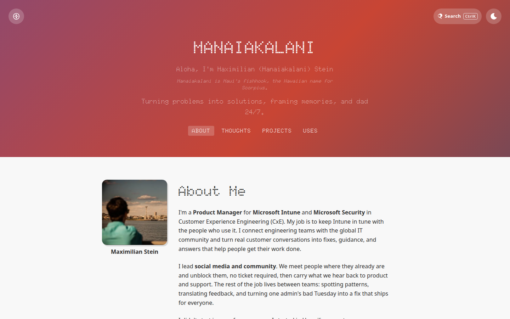

<div align="center">
  <picture>
    <source media="(prefers-color-scheme: dark)" srcset="docs/assets/logo-dark.svg" />
    
  </picture>
  <h1>Manaiakalani.com</h1>
  <p><strong>Personal site of Maximilian Stein, Product Manager for Microsoft Intune and Microsoft Security.</strong></p>
  <p>
    <a href="https://github.com/Manaiakalani/Manaiakalani.com/blob/main/LICENSE"></a>
    <a href="https://github.com/Manaiakalani/Manaiakalani.com/actions/workflows/azure-static-web-apps-gray-smoke-07ceed71e.yml"></a>
  </p>
  <p><a href="https://manaiakalani.com">Visit site</a> · <a href="#overview">Overview</a> · <a href="#local-development">Local Development</a></p>
  
</div>

## Overview

A lightweight, static personal site built with vanilla HTML, CSS, and JavaScript. Home/about, Thoughts, Projects (GitHub API), Uses, Now, a guestbook wall, a colophon, ⌘K, and a GeoCities mode behind the globe (or Konami, or typing `clippy`). Hosted on **Azure Static Web Apps** and deployed via GitHub Actions on every push to `main`. Pretty URLs (`/thoughts`, `/now`, …) rewrite to the `.html` files.

## Tech Stack

| Layer        | Technology                              |
| ------------ | --------------------------------------- |
| Markup       | HTML5 with semantic elements            |
| Styling      | CSS3 (custom properties, gradient animation) |
| Typography   | [Doto](https://fonts.google.com/specimen/Doto), self-hosted as WOFF2 in `fonts/` |
| Icons        | Inline SVG (no icon font or third-party icon library) |
| Hosting      | Azure Static Web Apps                   |
| CI/CD        | GitHub Actions                          |
| Analytics    | Self-hosted analytics (Rybbit) + real-user Web Vitals |
| Perf budgets | Lighthouse CI                           |
| Dependencies | Dependabot for workflow action updates  |

## Project Structure

```
├── .github/
│   ├── dependabot.yml          # Dependabot configuration
│   └── workflows/              # GitHub Actions CI/CD
├── .well-known/
│   └── security.txt            # Security contact info
├── tests/                      # Playwright fit-and-finish + spacing audits
├── api/                        # Guestbook + visitor counter (Azure Functions)
├── index.html                  # Home/About
├── thoughts.html               # Thoughts
├── projects.html               # GitHub projects
├── uses.html                   # Tools / studio kit
├── now.html                    # Seattle, desk, currently building
├── guestbook.html              # Sign the book
├── colophon.html               # How the site is made
├── 404.html                    # Custom 404
├── humans.txt / llms.txt
├── badge-88x31.png             # Hotlinkable homepage badge
├── style.css / geocities.css
├── icons.js                    # currentColor glyph set
├── components.js               # Shared header + footer
├── command-palette.js          # ⌘K
├── script.js / boot.js / geocities.js
├── search.json                 # Palette content index
├── sw.js / manifest.json       # PWA
├── feed.xml / sitemap.xml
└── staticwebapp.config.json    # CSP, routes, caching
```

## Local Development

No build step required. Open `index.html` in a browser or serve it locally:

```bash
# Python
python -m http.server 8000

# Node.js (npx)
npx serve .
```

## License

This project is licensed under the [MIT License](LICENSE).
